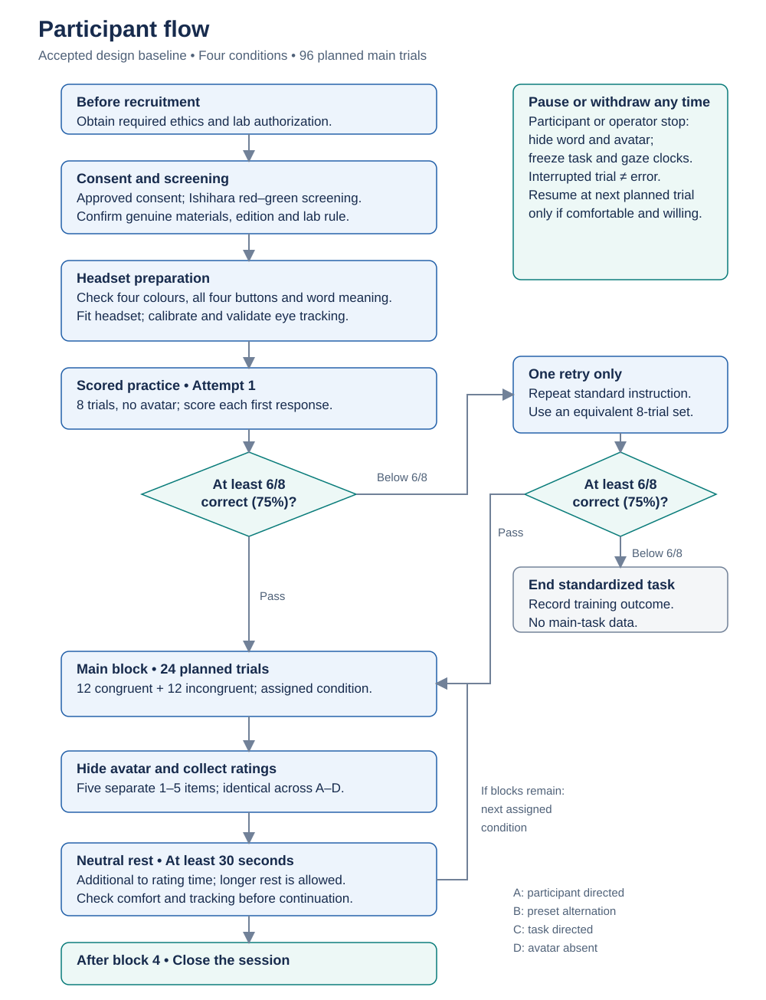
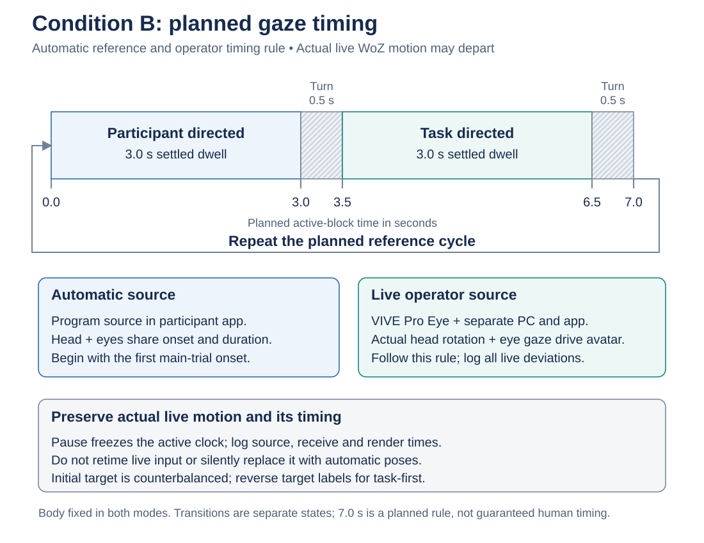

# Experiment diagrams

[Back to the experiment design](experiment-design.md)

These diagrams show the current design as directly viewable static SVGs. The control architecture is clarified on 28 October 2026. They describe the protocol and conceptual requirements, not completed software, validated device integration, or collected results.

**Rendering note:** GitHub reported “Unable to render rich display” for the Mermaid views during browser verification. Static SVGs are therefore shown below. The Mermaid source is updated alongside this revision and retained in expandable text blocks for editing in a compatible Mermaid renderer.

## Participant flow

[View the accessible static flowchart](assets/participant-flow.svg)



<details>
<summary>Editable Mermaid source</summary>

```text
flowchart TD
    AUTH["Required ethics and lab authorization before recruitment"] --> SCREEN["Approved consent and Ishihara red–green screening<br/>Genuine materials; edition and rule to confirm"]
    SCREEN --> SETUP["Actual-headset colour and button familiarisation<br/>Word understanding, fit, calibration and validation"]
    SETUP --> P1["Practice attempt 1<br/>8 trials, no avatar; score first responses"]
    P1 --> G1{"At least 6 of 8 correct<br/>(75%)?"}
    G1 -->|Pass| BLOCK["Next assigned condition<br/>24 planned trials: 12 congruent and 12 incongruent"]
    G1 -->|Below 6 of 8| RETRY["Repeat standard instruction<br/>One equivalent 8-trial retry"]
    RETRY --> G2{"At least 6 of 8 correct<br/>(75%)?"}
    G2 -->|Pass| BLOCK
    G2 -->|Below 6 of 8| TRAINEND["End standardized task<br/>Record training outcome; no main-task data"]
    BLOCK --> RATINGS["Hide avatar<br/>Five separate 1–5 ratings; same wording in A–D"]
    RATINGS --> REST["At least 30 seconds of additional neutral rest<br/>Extendable; comfort and tracking check"]
    REST --> FOUR{"Four blocks completed?"}
    FOUR -->|No| BLOCK
    FOUR -->|Yes| CLOSE["Close session under the approved procedure"]
    SAFETY["Pause or withdraw at any time<br/>Hide word and avatar; freeze both clocks<br/>Interrupted trial is not an error<br/>If continuing, use the next planned trial"]
```

</details>

The safety node applies throughout the session, not only after a block. Condition order is assigned from **ABDC, BCAD, CDBA, DACB**. There are four conditions and 96 planned main trials; interruption can reduce the number of valid completed trials.

The participant-flow SVG is retained from the preceding baseline. Its eye-tracking readiness step refers to the participant's own VIVE Pro Eye; acquisition, calibration, and usable measurement still require validation. The operator's separate VIVE Pro Eye supplies control input and cannot substitute for the participant's gaze stream.

## Seven second gaze cycle

[View the scaled static timeline](assets/gaze-timeline.svg)



The SVG uses a proportional **planned** time axis. It is the automatic reference and the live operator's timing rule, not a claim that actual human movement matches that trace. The Mermaid source describes a reference state sequence, **not** a time-scaled plot.

<details>
<summary>Editable Mermaid source</summary>

```text
flowchart LR
    REF["Automatic reference and live WoZ timing rule<br/>Retain actual human motion and timing deviations"] -.-> P
    P["Participant directed<br/>3.0 s settled dwell<br/>0.0–3.0 s"] --> PT["Turn to task<br/>0.5 s<br/>3.0–3.5 s"]
    PT --> T["Task directed<br/>3.0 s settled dwell<br/>3.5–6.5 s"]
    T --> TP["Turn to participant<br/>0.5 s<br/>6.5–7.0 s"]
    TP --> P
```

</details>

- This illustration begins at the participant target. Counterbalance the initial target independently of condition order; reverse the target labels for a task-first block.
- Begin with the first main-trial onset. Stop at block end and freeze the active clock during pauses.
- In the automatic reference, head and eyes share movement onset and duration. Live WoZ maps the operator's actual head rotation and eye gaze; do not force the human signal onto the automatic trajectory. The avatar body stays fixed in both modes. Transitions are separate logged states, not settled gaze.
- The automatic policy ignores participant responses, accuracy, and eye gaze. The operator must follow the assigned condition and timing rules rather than react to those participant measurements. Operator eye gaze is a control input in live WoZ.
- A planned full cycle lasts **7.0 seconds**, not 6 seconds; the target does not simply change every 3 seconds. Record actual dwell, turns, and deviations in live WoZ without silently substituting automatic playback.

## Conceptual control and logging

[View the accessible static architecture](assets/control-logging.svg)


<details>
<summary>Editable Mermaid source</summary>

```text
flowchart TD
    CONFIG["Locked block configuration and active clock<br/>Condition, mode, list or seed, initial B target"]
    CONFIG --> AUTO["Automatic source in participant application/PC<br/>Generate reference head-and-eye motion"]
    CONFIG --> RULES["Live WoZ condition and timing rules<br/>A-D retained; B uses 3.0 s dwell and 0.5 s turns"]
    RULES -.-> OPERATOR["Operator VIVE Pro Eye<br/>Separate operator computer and capture application"]
    OPERATOR --> CAPTURE["Operator application: actual head rotation and eye gaze<br/>Acquire samples with source identity, capture time and validity"]
    CAPTURE --> TRANSPORT["Real-time operator-PC to participant-PC transmission required<br/>SDK, protocol and network details still to verify"]
    TRANSPORT --> MAP["Participant application: receive and map actual head rotation and gaze<br/>Record real motion and deviations; no forced automatic trace"]
    AUTO --> PRESENT["Shared avatar presentation interface in participant application<br/>Same participant-visible avatar; body fixed"]
    MAP --> PRESENT
    PRESENT --> PARTICIPANT["Participant VIVE Pro Eye on participant computer<br/>Stroop task and avatar display"]
    INPUT["Participant's first valid new button press"] --> TRIAL["Stroop trial state<br/>Onset, response and accuracy"]
    PEYE["Participant VIVE Pro Eye gaze: own measurement stream<br/>Capture and calibration to validate; never operator gaze"] --> AOI["Validity and AOI classification<br/>Keep invalid tracking separate"]
    SURVEY["Five separate post-block ratings"]
    PRESENT --> LOG["Shared audit log: source and mode, operator head/eye samples<br/>Source capture, receive and render times<br/>Actual states, exposure, deviations and validity"]
    CAPTURE --> LOG
    TRANSPORT --> LOG
    MAP --> LOG
    TRIAL --> LOG
    AOI --> LOG
    SURVEY --> LOG
    SYNC["Design and verify clock synchronization, offset and drift<br/>End-to-end latency, packet loss and out-of-order delivery"] --> LOG
    FAIL["Tracking and transport fail-safe policy<br/>Still to specify and validate; no silent automatic fallback"] -.-> PRESENT
    STOP["Always-available safety stop<br/>Hide word and avatar; freeze both clocks"] -.-> CONFIG
    STOP -.-> TRIAL
    STOP -.-> PRESENT
```

</details>

The confirmed architecture uses **two VIVE Pro Eye headsets, two computers, and two applications**. The participant application/PC presents Stroop and the avatar to the participant's headset. The operator uses a separate VIVE Pro Eye, computer, and capture application. Operator head rotation and eye gaze must be acquired in that application, transmitted in real time, received in the participant application, and mapped to the same participant-visible avatar.

Choose **one control source per block**. In automatic mode the program source runs in the participant application/PC. In live WoZ the independent operator application/PC supplies actual head rotation plus eye gaze; buttons are not the WoZ target-selection source. Share the experimental flow, avatar presentation interface, questionnaires, and logging; do not claim the two modes share an identical trajectory implementation. The diagram does not create eight participant conditions.

The assigned A–D conditions and B's planned 3.0-second dwell plus 0.5-second turns remain rules for the operator to follow. Log actual motion and timing deviations. Do not force live signals to equal the reference trace, retime them to conceal deviations, or silently override them with automatic poses. Only head rotation and eye gaze are synchronized through live control; body translation or pose, hands, and voice are outside this scope, and the avatar body remains fixed.

**Operator eye gaze is a control input. Participant eye gaze is a distinct measurement stream from the participant's own VIVE Pro Eye; its acquisition and validity still require verification.** Participant responses, gaze, errors, and apparent distraction must not choose the avatar's targets. Never substitute operator gaze for participant measurements. Any use of headset position solely to maintain geometric target alignment must be documented separately.

Dual-device capture and real-time transmission are design requirements. VIVE Pro Eye and the separate operator computer/application are confirmed choices; the operator computer's detailed configuration and the actual connections/performance are not verified. SDK/runtime, communication protocol and network details, coordinate mapping, source/receive/render timestamp definitions, clock synchronization and offset/drift handling, end-to-end latency, packet loss, out-of-order delivery, tracking validity, and the fail-safe policy still require specification and validation. Record source/mode and operator head/eye samples alongside realized presentation and failure events; the figure does not claim these functions are implemented.
