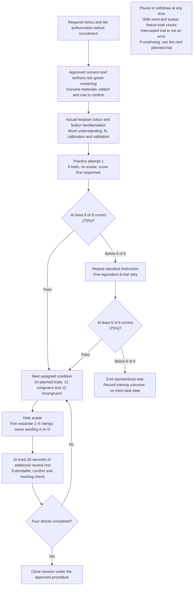
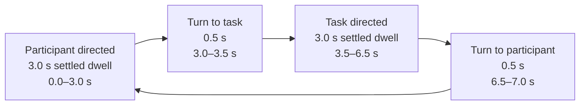
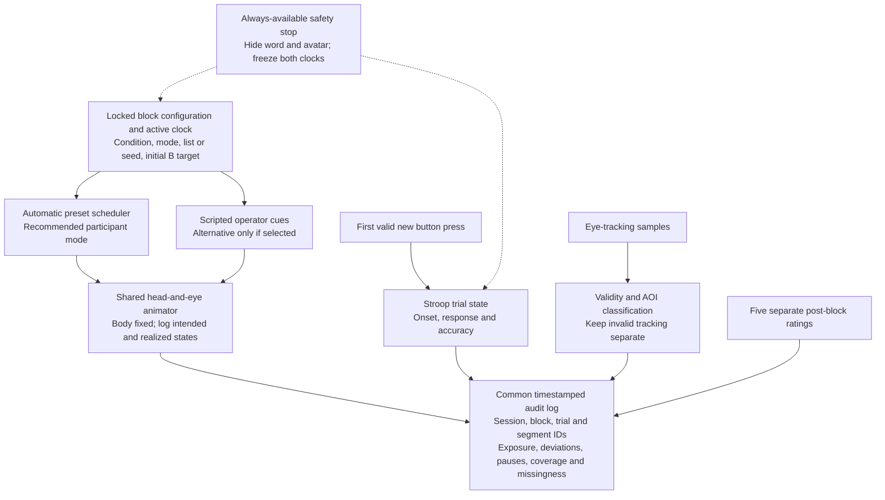

# Experiment diagrams

[Back to the experiment design](experiment-design.md)

These Mermaid diagrams provide editable, GitHub-native views of the accepted design. The linked static SVGs contain the same operational content and remain readable without Mermaid support. They describe the protocol and conceptual architecture, not completed software or collected results.

## Participant flow

[View the accessible static flowchart](assets/participant-flow.svg)

The safety node applies throughout the session, not only after a block. Condition order is assigned from **ABDC, BCAD, CDBA, DACB**. There are four conditions and 96 planned main trials; interruption can reduce the number of valid completed trials.

## Seven second gaze cycle

[View the scaled static timeline](assets/gaze-timeline.svg)

The SVG uses a proportional time axis. This Mermaid view is a state sequence, **not** a time-scaled plot.

- This illustration begins at the participant target. Counterbalance the initial target independently of condition order; reverse the target labels for a task-first block.
- Begin with the first main-trial onset. Stop at block end and freeze the active clock during pauses.
- Head and eyes share movement onset and duration; the body stays fixed. Transitions are separate logged states, not settled gaze.
- The preset policy ignores participant responses, accuracy and eye gaze. A full cycle lasts **7.0 seconds**, not 6 seconds; the target does not simply change every 3 seconds.

## Conceptual control and logging

[View the accessible static architecture](assets/control-logging.svg)

Choose **one control route per block**. Both routes use the same task, animation and logging design; free manual apparatus exploration is kept separate from standardized participant testing. The diagram does not create eight participant conditions.

Eye gaze and responses are measured outputs. They never feed the avatar target-selection policy. Any use of headset position solely to maintain geometric target alignment must be documented separately; it is not eye-gaze contingency.
