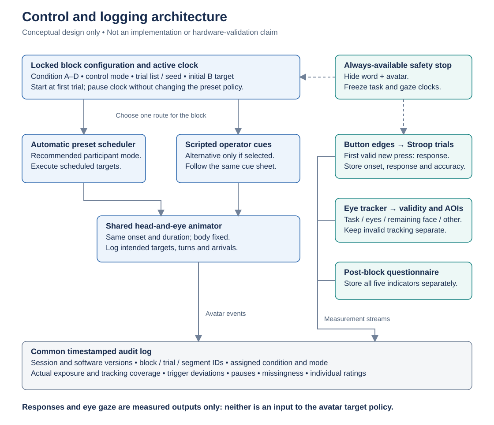

# VR Stroop avatar pilot experiment design

**Protocol baseline: 26 October 2026 · Within participant · Four conditions · 96 planned main trials**

This document records the latest user-accepted design for a lightweight pilot of avatar attentional orientation during a colour–word Stroop task. The pilot will assess whether the procedure is usable, the gaze manipulation is visible, and perceived evaluation and attention can be measured meaningfully before a larger study is planned.

**Status:** the design is accepted as the working baseline; it is not a validated standard, an implementation report, or evidence of ethics approval. Hardware, calibration performance, several lab procedures, and the participant protocol freeze still require confirmation. No participant results are presented here.

[Evidence and decision record](evidence-and-decisions.md) · [Editable Mermaid diagrams](diagrams.md) · [Repository home](../README.md)

## 1 Design at a glance

| Element | Accepted working baseline |
|---|---|
| Design | Each participant completes A, B, C, and D once |
| Main task | Select the **font colour**, ignoring the word meaning |
| Stimuli | RED, GREEN, BLUE, YELLOW in four corresponding ink colours |
| Main trials | **24 per block: 12 congruent + 12 incongruent; 96 planned trials overall** |
| Practice | 8 trials without an avatar; pass at **6/8 = 75%**; **two total attempts**, meaning one initial attempt and at most one retry |
| Avatar movement | Head and eyes move together; body remains fixed |
| Alternating gaze | 3.0 s settled dwell at each target + 0.5 s per turn = **7.0 s per full cycle** |
| Control | Automatic preset timing recommended for participant testing; scripted operator-button mode retained; free manual exploration kept separate |
| Post-block measures | Five separate, custom **1–5** experience items, identical across all four conditions |
| Rest | After ratings, at least **30 s of additional neutral rest**, extendable by the participant |
| Order | Williams sequences **ABDC, BCAD, CDBA, DACB** |
| Safety | Pause or withdraw at any time; an interrupted trial is not an error |

The numerical defaults are project-specific decisions. They should be checked on the apparatus and versioned before participant data collection, rather than presented as literature-validated thresholds.

## 2 Research question and conditions

The pilot asks whether preset avatar head-and-eye orientation patterns produce distinguishable experiences of evaluation, observation, worry, focus, and distraction, alongside measurable task and gaze behaviour.

Richard's term **attentional contingency** is retained with an explicit operational definition: **preset avatar head-and-eye attentional-orientation patterns, not real-time responsiveness to participant gaze or performance**. The visible character is a computer-controlled observer, although “avatar” is retained as the project term. Confirm the preferred final label with Richard.

| Code | Condition | Head and eyes during the active block | Role in the comparison |
|---|---|---|---|
| **A** | Participant directed | Remain oriented toward the participant target | Sustained participant-directed observer |
| **B** | Alternating | Alternate between participant and task targets on the preset clock | Alternating orientation, with visible transitions |
| **C** | Task directed | Remain oriented toward the task target | Task-focused observer, **not** an absent-observer baseline |
| **D** | Avatar absent | Avatar hidden | No-avatar baseline |

Keep avatar appearance, scene, task position, controller mapping, and other permitted animation features consistent across A–C. The avatar's body remains fixed. Participant gaze, mistakes, hesitation, and response speed must not select gaze targets. If headset position keeps the participant target geometrically aligned, document that limited position tracking separately from eye-gaze contingency.

These are comparisons of **assigned gaze policies over a fixed number of trials**, not equal-duration gaze doses. B also changes motion and transition frequency. The design cannot isolate a pure perceived-evaluation mechanism, establish mediation, or test reactive social contingency. The pilot should describe differences without assuming a particular ordering of the conditions.

## 3 Participant flow

*Figure 1. Planned participant procedure. Pause and withdrawal remain available throughout; the diagram does not grant permission to recruit.*

### Preparation before scored practice

1. **Authorization and consent.** Complete the applicable lab ethics process before participant research and recruitment. Use the approved consent and screening procedure. Informal apparatus checks are not a general exemption from ethics requirements.
2. **Colour-vision screening.** Use genuine Ishihara materials according to the actual edition/manual and lab-approved rule. The edition, administration procedure, and inclusion rule remain open. Ishihara is used here for red–green screening, not as a comprehensive test of all colour-vision deficiencies; the cited concise-edition instructions specifically exclude blue–yellow diagnosis. Do not substitute self-report, add HRR, or invent a universal plate threshold. [Ishihara instructions, introduction](https://web.stanford.edu/group/vista/wikiupload/0/0a/Ishihara.14.Plate.Instructions.pdf).
3. **Fit and task familiarisation.** On the actual headset, confirm recognition of all four displayed colours and demonstrate correct use of **each** colour-to-button mapping. Instruction and correction are allowed. This is familiarisation, not an undisclosed additional scored gate.
4. **Word and rule comprehension.** Check understanding of RED, GREEN, BLUE, and YELLOW and the instruction to select font colour rather than word meaning. Record relevant English-reading familiarity: recognising four words does not establish equivalent automatic reading.
5. **Eye-tracking readiness.** Calibrate and validate at the task and avatar locations. Confirm the actual headset and usable eye-versus-face resolution; do not assume these from a model name.

### Practice and the entry rule

| Step | Procedure | Decision |
|---|---|---|
| Attempt 1 | 8 trials; 4 congruent + 4 incongruent; no avatar | At least 6 first responses correct → proceed |
| If below 6/8 | Repeat the standard instruction and briefly review the demonstrated mapping | Offer one equivalent 8-trial set with a different order/content arrangement |
| Attempt 2 | Same scoring rule; no avatar | At least 6/8 → proceed; otherwise end the standardized task |

Within each practice congruency category, each ink colour appears once. The four incongruent items also use each word once, for example RED/green, GREEN/blue, BLUE/yellow, YELLOW/red. Score only the first response. After an error, show the correct font colour and response instruction, then wait for an explicit Continue action; correction does not change the score. Practice RT is not a main-task outcome.

Do not add a per-colour or per-congruency passing rule after someone reaches 6/8. Record attempts, first-response accuracy, error types, and technical issues. A failed practice is a training outcome, not a cognitive diagnosis. Any subsequent usability exploration must be separately labelled and must not become main-task data.

Criterion-based practice has a published precedent, but **6/8 and the two-attempt cap are our adaptations**. Patra et al. used eight practice items with an 80% criterion, which requires at least 7/8, and their task/context differed. [Patra et al., 2023, §2.3.1, p. 11](https://upload.wikimedia.org/wikipedia/commons/1/11/Variation_in_how_cognitive_control_modulates_sentence_processing.pdf).

## 4 Main task and stimulus balance

The first valid **new** button press records the response and advances immediately to the next stimulus. There is no forced three-second wait and no correctness feedback in the main task. Use press-edge/release handling so a held button cannot answer successive trials. Log actual stimulus onset and response time; do not silently add a response deadline.

### The 24-trial block

Each table cell is the **planned number of presentations in one block**, not a result. Bold diagonal cells are congruent.

| Word shown ↓ / Ink colour → | Red | Green | Blue | Yellow | Word total |
|---|---:|---:|---:|---:|---:|
| RED | **3** | 1 | 1 | 1 | 6 |
| GREEN | 1 | **3** | 1 | 1 | 6 |
| BLUE | 1 | 1 | **3** | 1 | 6 |
| YELLOW | 1 | 1 | 1 | **3** | 6 |
| **Ink total** | **6** | **6** | **6** | **6** | **24** |

- **12 congruent:** all four matched pairs, three repetitions each.
- **12 incongruent:** all twelve possible mismatched word–ink pairs, once each.
- Each word and ink colour appears three times within each congruency category.
- Prepare four constrained orders with identical multisets; avoid immediate repetition of the exact word–ink stimulus. Apply any further run-length constraints equally to all conditions. Store list IDs/seeds and vary list-to-condition assignment rather than fixing a potentially easier list to one condition.

Twenty-four is the smallest 50:50 block that includes all twelve distinct incongruent pairs. It improves balance relative to 10 + 10 trials, but does not by itself establish statistical power.

### Apparatus check before the participant protocol is frozen

Check completion time, gaze visibility, logging, and fatigue using the 24-trial baseline. A pragmatic engineering check is whether a competent, fast, accurate run includes at least **two complete seven-second cycles** in B and whether both directions are visibly distinguishable. This is not a validated psychological exposure dose or an individual participant exclusion criterion.

If exposure is too brief, a **future 48-trial block** may be proposed: 24 congruent plus 24 incongruent, 192 main trials overall. It requires a separate decision and approval before testing; it is **not** adopted here. Never add trials only for faster participants, continue until a participant reaches a gaze-cycle quota, or tune gaze timing from responses. Freeze the same count for the cohort and identify any later protocol version separately.

**Session duration is not yet established.** Measure it during apparatus checks, including screening, fitting/calibration, familiarisation, 8–16 practice trials, four main blocks, four questionnaires, rest, and any extra pauses. Fixed trial counts do not imply fixed block duration; no unmeasured minute estimate is treated as a participant commitment.

## 5 Condition order and initial gaze target

| Allocation sequence | Block 1 | Block 2 | Block 3 | Block 4 |
|---|---|---|---|---|
| 1 | A | B | D | C |
| 2 | B | C | A | D |
| 3 | C | D | B | A |
| 4 | D | A | C | B |

Use a pre-generated randomized allocation in sets of four for eligible participants entering the main task. With equal allocation, every condition occurs once at each position and all twelve ordered adjacent pairs occur once. D is not always first. Keep allocations as even as possible for incomplete sets and report assigned and completed sequence counts; withdrawals must not trigger outcome-based reassignment.

Balance B's initial target, participant or task, as evenly as practicable **independently** of sequence. This is a scheduling factor, not four additional conditions. The Williams arrangement balances position and first-order carry-over under equal allocation; it does not eliminate learning, fatigue, expectation, or higher-order carry-over. [Williams, 1949, publisher abstract](https://connectsci.au/ch/article-abstract/2/2/149/614/Experimental-Designs-Balanced-for-the-Estimation?redirectedFrom=fulltext).

## 6 Alternating gaze timing

*Figure 2. B with a participant-first initial target. Reverse the target labels for task-first sessions. The bar represents scheduled time, not measured data.*

| Active-block time | Avatar state | Duration |
|---|---|---:|
| 0.0–3.0 s | Settled at initial target | 3.0 s |
| 3.0–3.5 s | Transition to other target | 0.5 s |
| 3.5–6.5 s | Settled at other target | 3.0 s |
| 6.5–7.0 s | Transition back to initial target | 0.5 s |
| 7.0 s onward | Repeat until block end | 7.0 s per full cycle |

The avatar is already at its assigned initial target at the first main-trial onset, when the active gaze clock begins. Transition onsets are 3.0, 6.5, 10.0, 13.5… seconds; arrivals are 3.5, 7.0, 10.5, 14.0… seconds. **Do not describe this as changing targets every three seconds.**

Use one fixed smooth interpolation curve with no snapping. Head and eyes share transition onset and duration; the body stays fixed. Specify duration rather than an unqualified angular speed, since angular velocity also depends on target separation and rig geometry. Validate poses and trajectories on the actual apparatus.

The gaze clock is independent of response timing, correctness, and participant gaze. It stops at block end and freezes during a pause. Log participant-directed dwell, task-directed dwell, and transitions separately. Report realized exposure, cycles, switch count, and block duration: a block ending partway through a cycle need not have an exact 50:50 target-dwell split.

Published work motivates seconds-scale dwell and explicit transition timing, not these exact parameters. Gregory used 500-ms head turns but 30-ms eye movements, so synchronized 500-ms eyes are a project adaptation. [Gregory, 2021, Experiment 1, pp. 3–4](https://d-nb.info/1244731927/34). See the [evidence table](evidence-and-decisions.md#2-published-evidence-and-project-adaptations) for the remaining boundaries.

## 7 Automatic and operator control

Both planned software modes use the **same** Stroop task, animation implementation, questionnaires, and logging. Operator motion capture is not required. Their availability does not create an eight-condition experiment.

| Mode | Intended use | Restrictions |
|---|---|---|
| Automatic preset control | Recommended mode for standardized participant testing | Fixed schedule; no performance- or eye-gaze-triggered target selection |
| Scripted operator-button control | Participant testing only if explicitly selected in the frozen protocol | Same target–timestamp cue sheet, console countdown cues, trained operator, logged timing deviations |
| Free manual exploration | Apparatus development and demonstration | Label separately; never pool with standardized blocks as though equivalent |

Before each block, select and lock condition and control mode. A and C allow no discretionary target switches; D hides the avatar. In scripted B, the operator follows the preset cues, never errors, hesitation, gaze, or apparent distraction. Use written instructions and rehearsal, preferably with the same operator.

Log planned event time, button time, animation onset/arrival, wrong or missed triggers, operator ID, and deviation reason. After a missed switch, preserve the master schedule and flag the deviation; do not add an ad hoc double switch. Define an engineering tolerance from apparatus checks before testing. Manual timing approximates automatic execution; software-timed execution after advance operator confirmation should be labelled **operator-confirmed scheduled playback**.

*Figure 3. Conceptual responsibilities and data flow, not a claim that these components have been implemented or tested. Participant responses and eye gaze are recorded outcomes, not inputs to target selection.*

## 8 Post-block questionnaire

Hide the avatar before ratings. Use neutral researcher behaviour and identical wording, anchors, and item order in A–D. These are **five separate custom pilot indicators**, not a validated scale or a translated established instrument.

**Instruction:** “Please answer about the block you have just completed.”  
**中文：**“请根据刚刚完成的这一组作答。”

| Score | English anchor | Chinese anchor |
|---|---|---|
| 1 | Strongly disagree | 非常不同意 |
| 2 | Disagree | 不同意 |
| 3 | Neither agree nor disagree | 中立（既不赞同也不反对） |
| 4 | Agree | 同意 |
| 5 | Strongly agree | 非常同意 |

Present items in the order below in every block: focus and distraction first, then observation, evaluation, and apprehension.

| Order and construct | English item | Chinese equivalent |
|---|---|---|
| 1 · Task focus | During this block, I kept my attention on selecting the font colour. | 在刚才这一组中，我把注意力保持在选择字体颜色这件事上。 |
| 2 · Distraction | During this block, my attention was drawn away from selecting the font colour. | 在刚才这一组中，我的注意力被从选择字体颜色这件事上引开了。 |
| 3 · Feeling observed | During this block, I felt watched while completing the task. | 在刚才这一组中，我做任务时有被注视的感觉。 |
| 4 · Perceived evaluation | During this block, I felt that my task performance was being evaluated. | 在刚才这一组中，我觉得自己的任务表现正在受到评价。 |
| 5 · Evaluation apprehension | During this block, I worried about receiving a negative judgment of my task performance. | 在刚才这一组中，我担心自己的任务表现会受到负面评价。 |

**Scoring:** retain each item separately. Do not sum them, use one reliability coefficient to assert a common construct, or treat reverse-scored focus as a validated distraction measure. Observation, evaluation, worry, attention, and social presence are not interchangeable.

The no-avatar condition may still receive nonzero observation or evaluation ratings because the researcher or recording remains salient. Do not change the questions to mention the researcher only in D. Avatar-specific follow-ups, if later needed, must not replace the common four-condition outcomes.

**Optional descriptive attribution check** — decide whether to include it before freezing the questionnaire, then use it identically in all conditions:

“If you felt evaluated, what contributed to that feeling? Select all that apply.”  
“如果你有被评价的感觉，哪些因素使你产生这种感觉？可多选。”

- Virtual character, if present / 虚拟人物（若该组出现）
- Researcher / 研究人员
- Awareness that task performance was recorded / 知道任务表现会被记录
- Other / 其他
- Did not feel evaluated / 没有被评价的感觉
- Unsure / 不确定

“Did not feel evaluated” is exclusive of substantive source selections. Attribution is descriptive; it does not prove that a selected source caused the feeling.

Repeated questions may prime later blocks. Common wording and counterbalancing do not remove that risk. Check item comprehension in the approved pilot; confirm the administration language and Chinese wording before collection, and version any later revisions. The rationale for separating these constructs comes partly from robot-observer Stroop work, not from validation of these new items. [Koban, Haggadone, and Banks, 2021, Measures, pp. 5–6](https://assets.pubpub.org/hy2snuct/11630427850230.pdf).

## 9 Rest interruption and withdrawal

### After each block

1. End the active task and hide the avatar.
2. Collect the five ratings in the same neutral presentation.
3. Provide **at least 30 seconds of additional neutral rest**, excluding rating time. Enable Ready after the minimum; allow longer rest.
4. Check comfort/readiness neutrally. Allow headset removal. Recalibrate as needed after removal or fit adjustment and validate before continuing; use a brief validation at other block boundaries too.

Record actual break lengths and headset removal. Thirty seconds is a practical starting value, **not a proven washout interval**. The final block is followed by the same ratings and rest, then the approved closing procedure.

### At any time during a block

| Event | Required action | Data handling |
|---|---|---|
| Participant pause or operator safety stop | Immediately hide the word and avatar; enter a neutral paused state; stop task timing and the active gaze clock | Mark the current trial interrupted, not incorrect; no valid uninterrupted RT |
| Participant chooses to resume comfortably | Check headset/tracking as needed; give the same brief readiness countdown; restore the paused schedule state | Continue with the **next planned trial**; start a new logged segment; do not silently repeat or replace the interrupted item |
| Discomfort, distress, or withdrawal | Stop promptly and follow the approved lab procedure; continuing is never required | Preserve only what the consent/data-withdrawal arrangement permits; do not require a reason or exit questionnaire |
| Technical failure | Follow a pre-specified technical policy | Retain all attempted blocks in the audit trail; no automatic whole-block rerun |

Preserve completed valid trials and flag interrupted blocks. Report an uninterrupted-block sensitivity summary rather than automatically excluding the whole participant. Behavioural and gaze-data validity are separate decisions. Do not impute missing conditions or manufacture equal valid-trial counts.

## 10 Logging and pilot outputs

### Minimum records

| Record | Fields to retain |
|---|---|
| Session | Pseudonymous participant ID; protocol/software version; actual headset and sampling configuration; necessary consent/screening status; word/colour/button checks; practice attempts; sequence; B initial target; mode/operator |
| Trial | Condition; block/segment; list/seed; trial index; word; ink; congruency; intended and first actual response; accuracy; stimulus onset; response timestamp/RT; technical and interruption flags |
| Avatar state | Intended/realized target; planned trigger; button time where relevant; transition onset and arrival; animation duration; dwell and cycle counts; pauses and deviations |
| Eye tracking | Timestamp; validity; raw/calibrated gaze as appropriate; AOI assignment; calibration and validation outcomes |
| Questionnaire and breaks | Separate item responses; item version and language; actual rating/rest duration; readiness, headset removal, and optional attribution |

Use a common timing reference so trial, avatar, gaze, and pause events can be aligned. Keep simulated desktop input visibly labelled and separate from real eye-tracking data. Storage location, access, retention, identifier linkage, and withdrawal handling remain subject to the approved data-management plan.

### Gaze definitions

- Exclusive active-task AOI categories: **task, eyes, remaining face, other**. Invalid tracking is a separate status, never “other.” Eyes and remaining face must not overlap in exclusive counts; any combined face total must be explicitly labelled.
- For comparable task-attention proportions, use **valid active-task gaze time** as the stated denominator; also report valid-data coverage relative to total active-task time. Pause, questionnaire, and rest periods are outside active-task time.
- If validation cannot separate eyes from adjacent face reliably, use face-level analysis. Looking at a face is not equivalent to looking at the eyes, mutual gaze, or feeling evaluated. Any future mutual-gaze measure needs explicit spatial/temporal criteria and adequate calibration.
- D has no avatar eye/face AOI: mark these measures **structurally not applicable**, not comparable social-gaze observations of zero. Task-AOI measures remain available in all four conditions.

### What this pilot will report

Report recruitment-to-main-task flow, training outcomes, completion and pauses, block duration, realized gaze exposure, manual deviations if any, tracking coverage, item comprehension/distributions, discomfort, and data completeness. Summarize correct-trial RT and accuracy by condition and congruency with valid-trial counts.

Retain raw data and predefine technical validity and RT-processing rules. Do not select post hoc trimming or exclusions to obtain an expected result, and do not automatically adjust RT comparisons for block duration, which is largely produced by the RTs themselves.

The pilot sample size and precision objectives remain open. Neither 24 nor 48 trials per condition demonstrates adequate power for a condition-by-congruency interaction. A small, nonsignificant contrast is not evidence of no effect; later study planning requires a defined estimand and appropriate precision/power analysis.

## 11 Resolved decisions and open lab items

**Resolved for this working baseline:** four conditions including D; combined head-and-eye movement; 6/8 practice with two total attempts; 24 main trials per block; five separate common items; 3.0-s dwell and 0.5-s transitions; 30-s minimum additional rest; the four Williams sequences; automatic control recommended with a constrained manual alternative. These are no longer merely suggestions in this document, but remain subject to apparatus feasibility and the approved participant protocol.

| Open item | Evidence or decision needed before participant testing |
|---|---|
| Ethics and recruitment | Applicable approval and permitted recruitment; approved consent, safety/stop procedure, compensation, and data-withdrawal terms |
| Hardware and software | Confirm Windows PC, actual headset, compatible eye tracking, controller support, and build configuration; HTC VIVE Pro Eye and Unity are planning assumptions, not verified equipment or implementation |
| Geometry and mapping | Final button mapping, seated arrangement, target positions, avatar visibility, and participant-target definition |
| Eye-tracking precision | Calibration/validation evidence, AOI sizes/separation, sampling configuration, validity rules, and face-level fallback |
| Colour screening | Genuine Ishihara edition/manual, administration conditions, and lab-approved screening/inclusion rule |
| Apparatus feasibility | Verify 24-trial duration, two-cycle engineering screen, animation readability, fatigue, input handling, and log fidelity; separately approve any later 48-trial change |
| Participant control mode | Confirm automatic use for the frozen cohort protocol; if manual is required, specify operator training, cue sheet, and timing tolerance |
| Questionnaire | Confirm language, comprehension, Chinese equivalence, and whether the optional attribution item is included |
| Sampling and analysis | Pilot N and precision rationale, population/eligibility, sequence allocation, list assignment, technical exclusions, and planned descriptive analyses |
| Terminology and data handling | Confirm Richard's preferred final label; settle storage, access, retention, identifier linkage, and withdrawal handling |

**Document precedence:** this Markdown plan is the current design entry point. The older `docs/Avatar_Gaze_Experiment_Plan.docx` is retained as a historical version and is not updated or deleted by this documentation revision. The diagrams describe the plan, not completed software.
